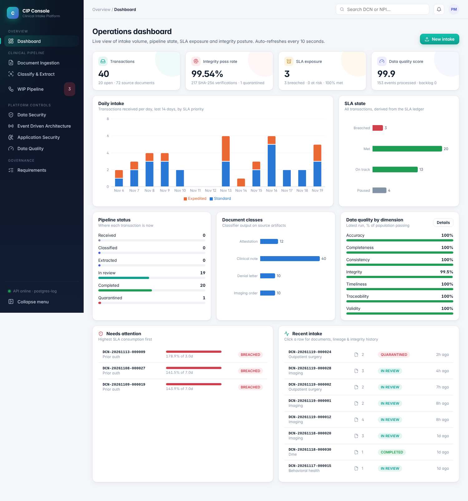
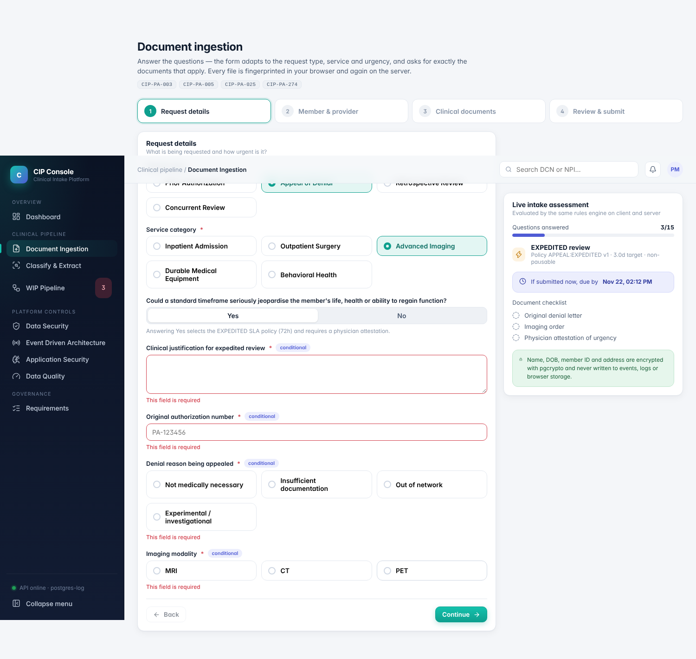

# CIP — Clinical Intake Platform (sample project)

A full-stack reference implementation of the 13 requirements in the CIP backlog sheet
(CIP-PA-003 … CIP-PA-658). It has a **Python / FastAPI** backend, a **React 19 + TypeScript** frontend
and **PostgreSQL 16** (with pgcrypto).



---

## 1. What you get

| Left-menu page | What it demonstrates | Requirements |
|---|---|---|
| **Dashboard** | KPIs, 14-day intake chart, SLA state, pipeline status, DQ by dimension, at-risk work queue | — |
| **Upload Documents** | Separate 5-page workflow: upload PDF or Word (.docx) → CIP reads the text, pre-fills request, member and provider fields (with confidence + evidence) and suggests document slots → confirm on separate pages → submit through the same ingestion engine. Samples in `docs/sample-documents/`. | 003, 005, 025, 274 |
| **Document Ingestion** | 4-step wizard. Questions appear or disappear based on earlier answers (declarative rules engine). Upload slots are conditional and required only when they apply. SHA-256 is computed in the browser and again on the server. | 003, 005, 025, 274 |
| **Classify & Extract** | Integrity checkpoints (steps 1/4/5/13/22), artifact table, three-way hash view, derivative lineage, **"Simulate tampering"** demo | 014, 025, 283 |
| **WIP Pipeline** | SLA board (ledger-derived), versioned SLA policies, outbox stream, run relay | 005, 064, 065 |
| **Data Security** | pgcrypto ciphertext viewer, role-gated **audited** decrypt, PHI-exclusion payload tester | 274, 275 |
| **Event Driven Architecture** | Topics, consumer-group offsets and lag, **replay an event to prove idempotency** | 065, 289 |
| **Application Security** | Prompt-injection sanitiser playground, minimum-necessary AI context builder, AI audit trail | 314, 315 |
| **Data Quality** | 11 SQL rules across 7 dimensions, risk-weighted score, trend | 658 |
| **Requirements** | Traceability matrix: requirement → code → evidence → screen | all |



---

## 2. Run it

### Option 0 — Windows, nothing installed (portable, no admin rights)
Double-click **`run-portable.bat`**. It unpacks `cip-runtime-win64.zip`, which bundles Python 3.12, PostgreSQL 16 and
every package. It then starts a private PostgreSQL on port 5433 and serves API + UI together at **http://127.0.0.1:8000**.
Keep the window open while you use the app; close it to stop.

### Option A — Docker (one command)
```bash
docker compose up --build
# UI  → http://localhost:5173
# API → http://localhost:8000/docs   (Swagger)
```

### Option B — local install (Windows / macOS / Linux)
Prerequisites: **Python 3.11+**, **Node 20+**, **PostgreSQL 14+**.

```bash
# 1. Database (once). Run as the postgres superuser:
psql -U postgres -f setup-database.sql

# 2. Backend  (Windows: start-backend.bat)
./start-backend.sh          # creates .venv, installs deps, runs on :8000

# 3. Frontend (Windows: start-frontend.bat), in a second terminal
./start-frontend.sh         # Vite dev server on :5173, proxies /api → :8000
```

On first start the API creates the schema, triggers and SLA policies. It then seeds **40 synthetic
transactions** through the real ingestion pipeline. All names and IDs are fictitious.

### Option C — cloud (Supabase + Render + Vercel)
Supabase hosts Postgres and document storage, Render runs the API and workers (`render.yaml`),
and Vercel serves the React app (`frontend/vercel.json`). Step-by-step guide: **[docs/DEPLOY.md](docs/DEPLOY.md)**.

### Tests
```bash
cd backend && pytest -q      # 25 tests: unit + end-to-end against real Postgres (uses DB cip_test)
```

---

## 3. Architecture

```
 React (Vite, TS)                         FastAPI (Python)                                  PostgreSQL 16
 ───────────────                          ────────────────                                  ─────────────
 Ingestion wizard ──multipart+manifest──▶ /api/ingestion/submit
  · rules engine (TS port)                 1 validate answers (same JSON rules)
  · Web-Crypto SHA-256                     2 stream → blob store, SHA-256 in 64KB chunks ─▶ ./storage/blob (+ x-ms-meta-sha256)
                                           3 magic-byte sniff, client-hash compare
                                           4 ONE DB txn: member(pgcrypto) + DCN txn + ─────▶ members / transactions / documents
                                             SLA START + docs + outbox (PHI-guarded)        sla_events (append-only trigger)
                                                                                            outbox_events
 Workers (thread / separate process)
   OutboxRelay  SELECT … FOR UPDATE SKIP LOCKED ─▶ broker (Postgres log | Kafka) ──────────▶ broker_log
   Consumers    dedupe(event_id,group) → handle → commit offset (1 txn) ────────────────────▶ processed_events, consumer_offsets
                 classifier: verify hash (step 4) → classify
                 extractor:  verify hash (step 5) → derivative + ICD/CPT
 Decision API    verify hash (steps 13, 22) → SLA COMPLETE   | fail → QUARANTINE + IntegrityViolation event
 AI gateway      capability allowlist → PHI scan → sanitise → fixed system prompt → model → ai_audit
```

### Design decisions worth explaining in an interview
* **The SLA clock is derived, never stored.** `compute_status()` replays an append-only event ledger against the
  policy *version* captured at START. Later policy changes cannot rewrite history. Postgres triggers
  reject any `UPDATE` of intake timestamps or DCN, and any `UPDATE/DELETE` on `sla_events` and `integrity_checks`.
* **No dual-write.** Events are inserted into `outbox_events` inside the business transaction. `SKIP LOCKED`
  lets N relay replicas run without double-claiming rows. Failed publishes retry with exponential backoff and are
  dead-lettered after 5 attempts.
* **Exactly-once outcomes from at-least-once delivery.** Each consumer does three things in one DB transaction:
  `INSERT … ON CONFLICT DO NOTHING` into `processed_events`, the business change, then the offset commit.
  You can try it with *Replay* on the Events page.
* **PHI cannot leak by accident.** The event payload goes through a per-event-type field allowlist and a pattern scan
  (`phi_guard.enforce`). This runs before the outbox row is written. A developer who adds `member_dob` to an event
  gets a failing test, not a breach.
* **Integrity is a three-way check.** The hash recomputed from the stored bytes must match the DCN record and the
  blob metadata. Comparison is constant-time (`hmac.compare_digest`). Hashing uses `hashlib.sha256(usedforsecurity=True)`
  (FIPS-approved).
* **One rules definition, two engines.** The questionnaire JSON is served to React (`lib/rules.ts`) for instant UX.
  It is re-evaluated in Python (`services/questionnaire.py`), which is the authority: hidden answers are stripped and
  required-ness is re-derived. Custom validators include the NPI Luhn check-digit, ICD-10 and CPT formats.
* **AI guard rails are structural.** Each capability declares the fields it may receive. Untrusted text is
  normalised (NFKC), stripped of invisible characters, scanned with 7 injection detectors, neutralised and capped at
  2000 characters. High-risk input never reaches the model.

---

## 4. Five-minute demo script
1. **Document Ingestion** → choose *Appeal of Denial* + *Advanced Imaging* + urgent **Yes**. Watch the conditional
   questions appear, the SLA policy flip to `APPEAL:EXPEDITED` (72h, non-pausable) and the document checklist grow.
   Try NPI `1234567890` (fails the check digit), then `1234567893`.
2. Upload files, see each SHA-256 computed in the browser, submit, and read the **DCN receipt**
   ("identical" = browser hash equals server hash).
3. **WIP Pipeline** → open the new DCN → *Documents & lineage* shows INGESTION → CLASSIFY → EXTRACT checks and the
   derivative text artifact.
4. **Classify & Extract** → open a document → **Simulate tampering** → **Re-verify** → fail, and the transaction is quarantined.
   *Approve* is now blocked (HTTP 423).
5. **Data Security** → *Reveal* as `analyst` (masked) and then as `clinical_reviewer` (decrypted). Both attempts are audited.
6. **Event Driven Architecture** → open a message → **Replay** → "duplicates skipped 1, processed 0".
7. **Application Security** → *Instruction override* → Sanitise → HIGH risk. Call the gateway with `member_name` in
   the candidate and it is blocked.

---

## 5. Project layout
```
backend/app
  core/        config.py (env settings) · db.py (engine, triggers, partial index)
  security/    hashing.py · phi_guard.py · prompt_guard.py · field_crypto.py
  services/    questionnaire · ingestion · storage · integrity · sla · outbox · broker
               consumers · extraction · ai_gateway · data_quality · requirements_catalog
  api/         ingestion.py · transactions.py · platform.py · serializers.py
  models.py    14 tables, each annotated with the requirement it serves
  workers.py   relay + consumer loop (python -m app.workers to run standalone)
  seed.py      synthetic demo data through the real pipeline
backend/tests  unit + integration (real Postgres)
frontend/src
  api/         typed client (axios) + domain types
  lib/         rules.ts (rules engine port) · hash.ts (Web Crypto) · format.ts · palette.ts
  components/  Layout (sidebar) · ui kit · TransactionDrawer
  pages/       one lazily-loaded chunk per menu item
```

## 6. Production notes
* Swap `LocalBlobStore` for `azure-storage-blob` (same 4 methods). Load `CIP_FIELD_ENCRYPTION_KEY` from Key Vault.
* Set `CIP_KAFKA_BOOTSTRAP_SERVERS` and `pip install confluent-kafka`. The producer uses `acks=all` and idempotence.
* Run the workers as their own deployment (`python -m app.workers`) with `CIP_WORKERS_ENABLED=false` on the API.
* Implement `LLMClient.complete` in `ai_gateway.py` with the Anthropic SDK to call Claude. The guard rails stay the same.
* Add authentication (OIDC/JWT). Roles are currently passed explicitly for demo purposes.
